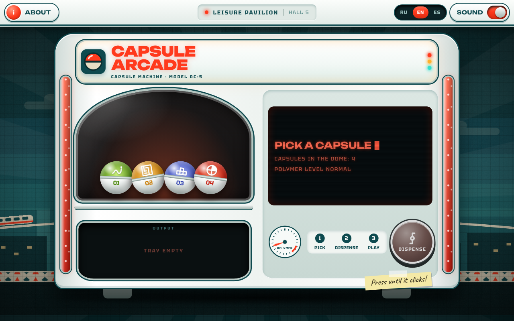

<p align="center">
  
</p>

# Capsule Arcade

**Cozy games, one capsule at a time.**

Capsule Arcade is a place for cozy, nostalgic games. Pick a capsule from the machine, get a game. It runs in the browser, on a computer and on a phone, and the site speaks English, Russian and Spanish.



## Games

| Game     | What it is                                                  |
| -------- | ----------------------------------------------------------- |
| Snake    | Grow and don't crash into yourself.                         |
| Pac-Man  | Eat everything in the maze and don't get caught. See below. |
| Tetris   | Fit the pieces into solid lines.                            |
| Simon 1C | Repeat the sequence and finish the block.                   |

**Pac-Man** is the largest game: two heroes (Pac-Man and Ms. Pac-Man), four seasonal mazes, a boss level in hell on every fifth level, and graphics drawn entirely in code (PixiJS, Canvas2D, WebGL2), with no sprites. The design is in [`DESIGN.md`](src/games/pacman/DESIGN.md), the code in [`ARCHITECTURE.md`](src/games/pacman/ARCHITECTURE.md) and the plan in [`ROADMAP.md`](src/games/pacman/ROADMAP.md).

## Run it

```sh
npm install
npm run dev      # development server
npm run build    # production build
npm run preview  # serve the production build
```

## Checks

```sh
npm run check    # svelte-check and TypeScript
npm test         # unit tests (Vitest)
npm run lint     # Prettier and ESLint
npm run format   # fix formatting
```

Hand-tuned art prototypes for Pac-Man live in `prototypes/pacman/`; build one with `node prototypes/pacman/build.mjs <name>`.

## How it is built

- SvelteKit with Svelte 5 and TypeScript, Tailwind CSS 4, PixiJS for the games.
- `src/routes/` holds the pages: the home page with the capsule machine, `/about`, an error page and one route per game.
- `src/shared/` holds what the pages share: the game list (`config/games.ts`), the pavilion interface (`ui/`), score storage and the translations.
- `src/games/<game>/` holds each game.
- Texts live in `src/shared/i18n/`, one file per language (`en.ts`, `ru.ts`, `es.ts`). `en.ts` defines the keys and the other two must match it, which the type checker enforces. Game titles and descriptions are there too (`game.<id>.*`). The text inside the games themselves is not translated yet.
- The language is chosen by the switch in the top bar, remembered in the browser, and taken from the browser's settings on the first visit.
- The icon is `static/favicon.svg`; the PNG sizes next to it are rendered from the same drawing.

## License

[MIT](LICENSE)

---

## По-русски

Capsule Arcade — место для уютных и ностальгических игр. Выбираешь капсулу в автомате, получаешь игру. Работает в браузере, на компьютере и на телефоне, сайт говорит по-русски, по-английски и по-испански.

Запуск: `npm install`, затем `npm run dev`. Проверки: `npm run check`, `npm test`, `npm run lint`. Язык переключается в верхней панели. Тексты лежат в `src/shared/i18n/`. Самая большая игра — Пакман, его описание и план в `src/games/pacman/`. Лицензия MIT.

## En español

Capsule Arcade es un lugar para juegos acogedores y nostálgicos. Eliges una cápsula en la máquina y recibes un juego. Funciona en el navegador, en el ordenador y en el móvil, y el sitio está en español, inglés y ruso.

Para arrancar: `npm install` y luego `npm run dev`. Comprobaciones: `npm run check`, `npm test`, `npm run lint`. El idioma se cambia en la barra superior. Los textos están en `src/shared/i18n/`. El juego más grande es Pac-Man; su diseño y su plan están en `src/games/pacman/`. Licencia MIT.
